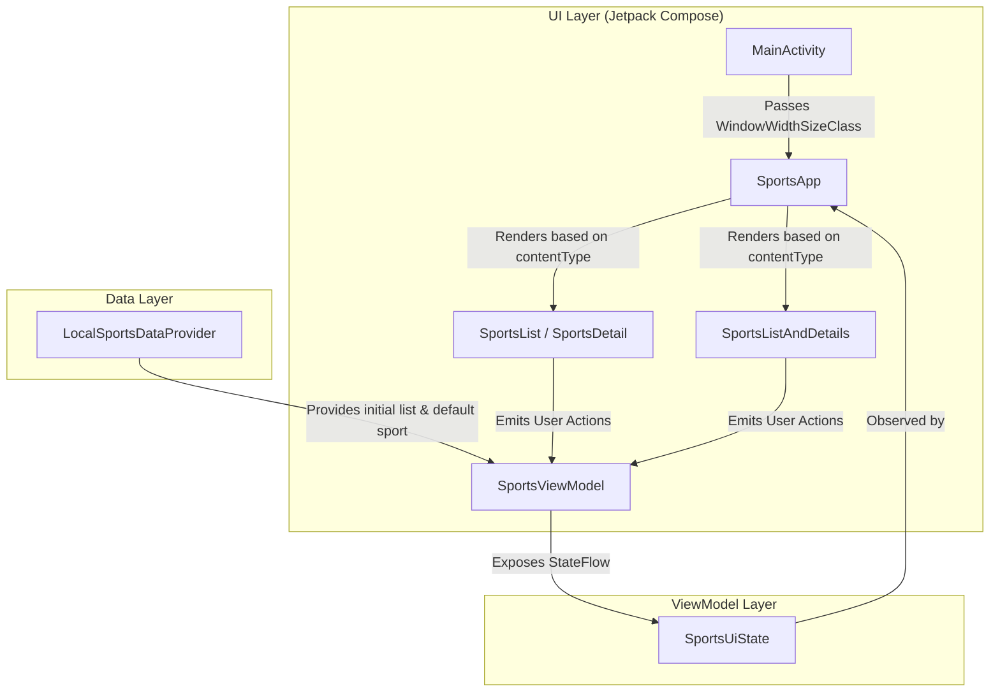
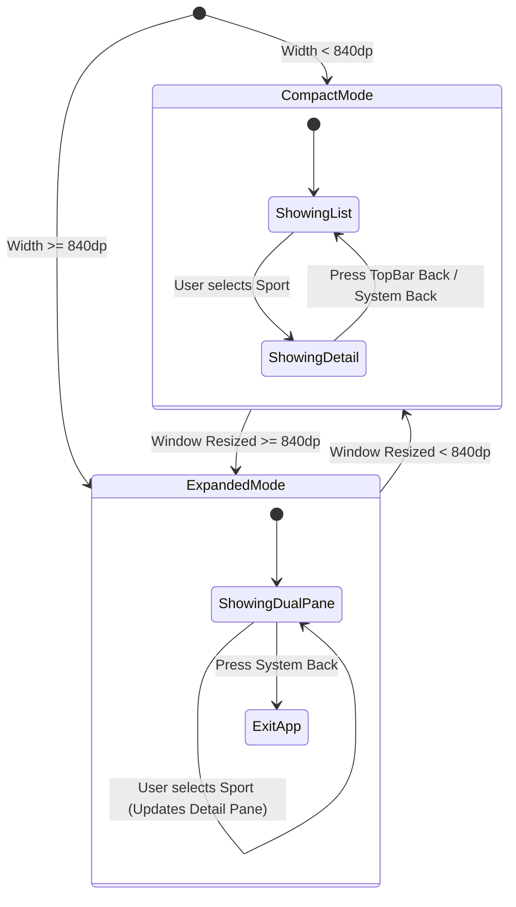
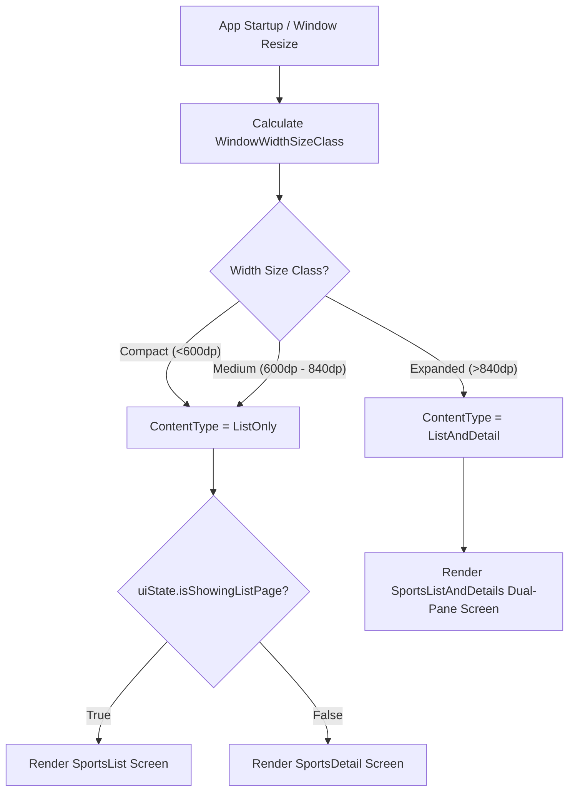

# Comprehensive Repository Analysis & Technical Overview: Sports App

## Executive Summary

The **Sports App** is a modern Android application built with **Jetpack Compose** and **Material 3**. Designed as a benchmark implementation for adaptive Android UI development, the application dynamically restructures its interface based on screen dimensions and window size classes (`WindowWidthSizeClass`). It shifts seamlessly from a single-column list-detail stack on compact displays (smartphones) to a multi-pane canonical List-Detail layout on expanded displays (tablets, foldables, and desktops).

This document evaluates the codebase through three complementary industry lenses:
1. **Software Architect** — System design, state flow, layout adaptation strategies, and enterprise readiness.
2. **Software Developer** — Implementation patterns, UI composition, Material 3 theming, edge-to-edge rendering, and maintainability.
3. **Product Manager** — User flows, form factor experience, accessibility, localization, and feature growth roadmap.

---

## 1. Software Architect Perspective

### 1.1 System Architecture & Design Patterns
The application implements modern Android architectural best practices adhering to the **Unidirectional Data Flow (UDF)** and **Model-View-ViewModel (MVVM)** design patterns.

```
+-----------------------------------------------------------------------+
|                             UI Layer                                  |
|   MainActivity -> WindowSizeClass -> SportsApp -> SportsScreens       |
+-----------------------------------------------------------------------+
                                  ^ |
                 UI State Flow    | |  User Actions (Clicks, Nav)
                  (StateFlow)     | v
+-----------------------------------------------------------------------+
|                           ViewModel Layer                             |
|                           SportsViewModel                             |
+-----------------------------------------------------------------------+
                                  ^ |
               Raw Data Loading   | |  (Future: Query / Mutations)
                                  | v
+-----------------------------------------------------------------------+
|                            Data Layer                                 |
|                       LocalSportsDataProvider                         |
+-----------------------------------------------------------------------+
```

* **Unidirectional Data Flow (UDF)**: UI state is held inside `SportsViewModel` as a `StateFlow<SportsUiState>`. The UI composables observe this state via `collectAsState()`. User interactions (e.g., selecting a sport, navigating back) trigger intent functions on the ViewModel (`updateCurrentSport`, `navigateToListPage`, `navigateToDetailPage`), which emit new immutable copies of `SportsUiState`.
* **State Encapsulation**: State mutations are restricted to `SportsViewModel` using private `MutableStateFlow` backing properties exposed as public read-only `StateFlow`.
* **Window Size Class Decoupling**: The host Activity (`MainActivity`) calculates device window metrics using `calculateWindowSizeClass(this)` and passes `widthSizeClass` down to the root composable (`SportsApp`). This decouples UI component rendering from platform-specific Activity contexts.

### 1.2 Adaptive Layout Strategy (Canonical Form Factors)
The app implements the Material Design **List-Detail Canonical Layout**:

| Window Width Size Class | Threshold | Strategy | Content Type (`SportsContentType`) |
| :--- | :--- | :--- | :--- |
| **Compact** | `< 600dp` | Single column; page navigation between List and Detail screens | `ListOnly` |
| **Medium** | `600dp - 840dp` | Single column; optimized list card dimensions | `ListOnly` |
| **Expanded** | `> 840dp` | Dual-pane side-by-side display (`SportsListAndDetails`) | `ListAndDetail` |

### 1.3 Architectural Assessment & Scalability

#### Strengths:
* **Stateless Composables**: Components (`SportsList`, `SportsDetail`, `SportsListAndDetails`) are parameter-driven and stateless, enabling previewability and unit testing.
* **Responsive Window Class Logic**: Screen layout decisions rely on `WindowWidthSizeClass` rather than hardcoded orientation checks or hardware device types.
* **Memory Safety**: Backing context handles activity teardowns cleanly without leaking lifecycle contexts.

#### Architectural Bottlenecks & Refactoring Needs:
1. **Lack of Repository Abstraction**: `SportsViewModel` directly imports `LocalSportsDataProvider`. Introducing a `SportsRepository` interface will decouple the ViewModel from static data sources and facilitate unit testing with mock data or remote APIs.
2. **Missing Dependency Injection**: ViewModels are currently instantiated using standard `viewModel()`. Integrating **Hilt** or **Koin** will improve modularity and testability.
3. **In-Memory Navigation**: Navigation is currently driven by a boolean flag (`isShowingListPage`) inside `SportsUiState`. Moving to **Jetpack Navigation 3** or Compose Navigation will support deep-linking, multi-stack navigation, and custom transition animations.

---

## 2. Software Developer Perspective

### 2.1 Codebase Structure
The project follows a feature-by-layer package organization:

```
app/src/main/java/com/example/sports/
├── MainActivity.kt                  # Activity entry point with Edge-to-Edge & WindowSizeClass calculation
├── data/
│   └── LocalSportsDataProvider.kt   # Mock dataset provider
├── model/
│   └── Sport.kt                     # Core data model entity
├── ui/
│   ├── SportsScreens.kt             # UI Composables (App, TopBar, List, Detail, Expanded)
│   ├── SportsViewModel.kt           # ViewModel & SportsUiState
│   └── theme/
│       ├── Color.kt                 # Material 3 Light/Dark color tokens
│       ├── Theme.kt                 # SportsTheme wrapper with dynamic color logic
│       └── Type.kt                  # Typography definitions
└── utils/
    └── WindowStateUtils.kt          # SportsContentType enum (ListOnly, ListAndDetail)
```

### 2.2 Implementation Breakdown

#### `MainActivity.kt`
Sets up edge-to-edge layout via `enableEdgeToEdge()`, calculates `WindowSizeClass`, and hosts the `SportsApp` composable inside a Material `Surface`. Includes `@Preview` entry points for both Compact and Expanded screen sizes.

#### `SportsScreens.kt`
Contains the core composable hierarchy:
* **`SportsApp`**: Container managing top-level `Scaffold`, top app bar title updates, and layout switching based on `SportsContentType`.
* **`SportsAppBar`**: Dynamically adapts navigation icons and top app bar title based on screen state.
* **`SportsListItem`**: Material 3 `Card` item displaying sport banner thumbnail, title, subtitle, player count using `pluralStringResource`, and Olympic badge.
* **`SportsList`**: Efficient `LazyColumn` for scrollable list rendering.
* **`SportsDetail`**: Scrollable view displaying full banner image, gradient overlay, detailed description, player metrics, and integrated system `BackHandler`.
* **`SportsListAndDetails`**: Side-by-side `Row` combining `SportsList` (`weight(2f)`) and `SportsDetail` (`weight(3f)`).

#### `Color.kt` & `Theme.kt`
Configured with Material Design 3 color roles:
* Primary palette: Forest green (`0xFF346A22`) with dark/light variants.
* Text color tokens properly mapped (`md_theme_light_onSurface = 0xFF1A1C18`) ensuring high-contrast rendering across light and dark system modes.

### 2.3 Code Quality & Maintainability Matrix

| Aspect | Status | Developer Notes |
| :--- | :--- | :--- |
| **Material 3 Tokens** | Excellent | Uses `MaterialTheme.colorScheme` and `MaterialTheme.typography` throughout. |
| **Preview Coverage** | High | Previews exist for list items, list, dual-pane, compact app, and expanded app. |
| **Edge-to-Edge** | Compliant | Scaffold padding (`innerPadding`) properly propagated to inner composables. |
| **Back Navigation** | Robust | System `BackHandler` integrated for single-page view; safe activity finish on expanded view. |
| **Resource Management** | High | String IDs, drawables, dimens, and plurals sourced from `res/values`. |

---

## 3. Product Manager Perspective

### 3.1 Core Features & Value Proposition
* **Content Delivery**: Provides structured sports overview cards and rich detail articles.
* **Seamless Screen Adaptation**: Users moving between portrait smartphones, landscape foldables, or desktop windows receive an optimal reading experience without UI truncation or awkward stretching.
* **Localized Plural Handling**: Uses native Android plural strings (`1 Player` vs. `X Players`).

### 3.2 User Experience & Layout Comparison

```
+---------------------------------+  +-----------------------------------------------------+
|        Compact (Phone)          |  |                 Expanded (Tablet/Desktop)           |
| +-----------------------------+ |  | +--------------------+ +--------------------------+ |
| | [Bar] Sports                | |  | | [Bar] Sports       | | [Detail Header]          | |
| +-----------------------------+ |  | +--------------------+ +--------------------------+ |
| | [Card] Baseball             | |  | | [Card] Baseball    | | Banner Image             | |
| | [Card] Badminton            | |  | | [Card] Badminton   | | Player Count / Olympic   | |
| | [Card] Basketball           | |  | | [Card] Basketball  | | Detailed Text Article... | |
| +-----------------------------+ |  | +--------------------+ +--------------------------+ |
+---------------------------------+  +-----------------------------------------------------+
```

### 3.3 Usability & Form Factor Matrix

| Form Factor | Screen Mode | UX Behavior | Usability Rating |
| :--- | :--- | :--- | :--- |
| **Smartphone (Portrait)** | Single-pane List | Clean card scrolling; tapping item opens Detail screen with back arrow. | 5/5 |
| **Smartphone (Landscape)** | Dual-pane or List | Automatically adapts based on width DPI threshold. | 4.5/5 |
| **Foldable (Unfolded)** | Dual-pane List-Detail | Instant context preservation; selecting a list item updates detail pane without screen transitions. | 5/5 |
| **Tablet / Desktop** | Dual-pane List-Detail | Side-by-side workflow maximize wide aspect ratio screen real estate. | 5/5 |

### 3.4 Accessibility & Internationalization Audit
* **Content Descriptions**: Images specify appropriate `contentDescription` or explicitly pass `null` for decorative graphics.
* **Touch Targets**: Standard `Card` components satisfy Material 3 minimum 48dp touch target guidelines.
* **Text Scaling**: Uses `sp` typography dimensions for accessibility text scaling support.

---

## 4. Architectural & System Workflow Diagrams

### Diagram 1: System Component Architecture & Unidirectional Data Flow



### Diagram 2: Screen State Transition & Navigation Flow



### Diagram 3: Adaptive Layout Decision Logic



---

## 5. Actionable Insights & Strategic Recommendations

### 5.1 Architectural Refactoring Roadmap
1. **Implement Repository Pattern**:
   Create a `SportsRepository` interface and `LocalSportsRepositoryImpl` class to abstract data fetching from `LocalSportsDataProvider`.
2. **Integrate Jetpack Navigation 3**:
   Migrate from state-flag navigation (`isShowingListPage`) to Jetpack Navigation 3 or Compose Navigation for deep-linking support, backstack restoration, and transition animations.
3. **Introduce Dependency Injection (Hilt)**:
   Annotate ViewModels with `@HiltViewModel` to enable clean dependency injection and facilitate mock testing.
4. **Unit & UI Testing Strategy**:
   * Add ViewModel unit tests covering state transitions (`updateCurrentSport`, `navigateToListPage`, `navigateToDetailPage`).
   * Add Compose UI tests (`SportsScreenTest`) using `createComposeRule()` to verify layout switching between Compact and Expanded window classes.

### 5.2 Product & UX Feature Roadmap
1. **Search & Filter Functionality**: Add a search bar to filter sports by category, player count, or Olympic status.
2. **Favorites / Bookmarking**: Allow users to pin favorite sports to the top of the list.
3. **Dynamic Remote Feed**: Transition static local sports data to a live sports news REST API or GraphQL backend.
4. **Multi-Window & Drag-and-Drop**: Support split-screen dragging of sports details or sharing sports content across app windows.

---

## 6. Project Checklist & Verification

* [x] **Adaptive Layout Integration**: Implemented Material 3 List-Detail canonical layout.
* [x] **WindowSizeClass Computation**: Computed via `calculateWindowSizeClass()` in `MainActivity`.
* [x] **Dual-Pane Composable**: Created `SportsListAndDetails` in `SportsScreens.kt`.
* [x] **Compose Previews**: Verified previews across compact and expanded screen specs.
* [x] **Color Palette Contrast**: Updated theme tokens (`onSurface` / `onSurfaceVariant`) for high-contrast accessibility.
* [x] **Build Verification**: Clean Gradle compilation (`./gradlew app:assembleDebug`).
